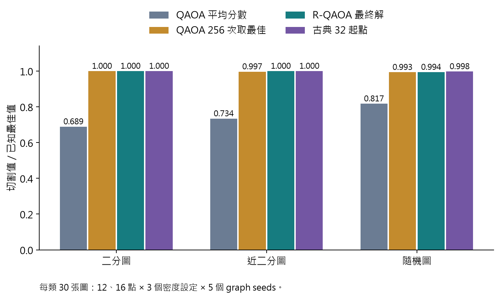
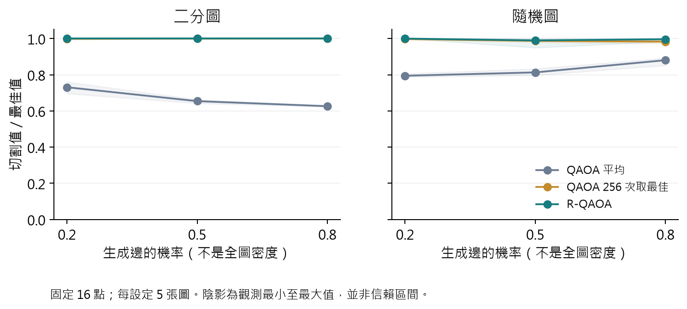
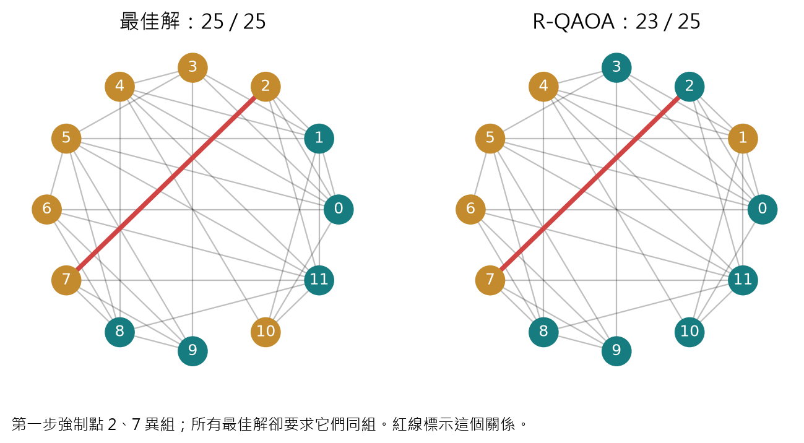
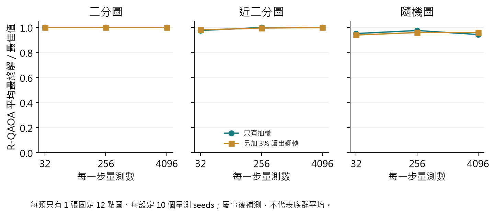

# Recursive QAOA 實測報告

## 這次確實救回二分圖，但沒有證明量子優勢

報告日期：2026-11-07 ｜ 對象：Johnny 與量子競賽團隊 ｜ 本機 CPU 模擬

## 先讀這三個結果

**R-QAOA 跑得通，也能改善標準淺層 QAOA 的平均分數。** 98 張主實驗圖中，94 張找到最佳解。30 張二分圖、30 張近二分圖都找到最佳解；30 張一般隨機圖中有 4 張失敗。另有 8 張固定結構控制圖全數成功。這是指定樣本的結果，不是所有圖的保證。

**「平均分數變高」不等於實際拿到的最佳答案大幅變好。** 同批隨機圖，QAOA 平均分數的近似比為 0.8174；但量測 256 次再挑最好答案，平均已達 0.9935。R-QAOA 的最終解平均為 0.9941，差距只有約 0.0006。兩者使用的總資源不同，不能據此宣布勝負。

**沒有看到勝過古典方法的證據。** 32 起點古典單點翻轉在全部 98 張圖中有 96 張找到最佳解；二分圖更可用著色直接求最佳解。p=1 相關性本身能用古典解析式計算，本實驗沒有量子計算加速。

## 這份成果可以怎麼定位

可以回報：「我已建立可重跑的 Recursive QAOA，比較它在不同圖上的改善、失敗原因和資源代價。」目前不適合回報「提出新量子演算法」或「超越古典」。

正文附 98 張圖的結果、180 次有限量測補測、45 次終止大小補測、4 個放大案例及失敗診斷。原始 CSV、每步縮圖記錄和程式都在同一專案。

---

## R-QAOA 到底在做什麼？

## 把大分組問題變小，再把答案展開

MaxCut 要把一張網路的點分成 A、B 兩組，讓跨組的邊最多。標準 QAOA 調整量子線路的參數，產生一個「不同分組答案的機率分布」，再從量測中取答案。它不是保證掉到全域最低能量。

R-QAOA 多做了一件事：觀察哪些點傾向同組、哪些傾向異組，先固定一個關係，再消去一個變數。

**1. 跑一層 QAOA。** 在目前的圖上調好 gamma、beta。

**2. 量兩點的關係。** 相關性 M(i,j)=〈ZiZj〉接近 +1，代表常同組；接近 -1，代表常異組。0 代表沒有明確方向。

**3. 選絕對相關性最大的點對。** 若選到 A、B 且 M=-0.8，就先假設 B 必須跟 A 異組。注意：這只表示該機率分布偏向異組，不是證明最佳解一定如此。

**4. 把 B 合併進 A。** B 與其他點的作用變成 A 的新權重；權重可能變負，不能當成普通無權重圖重新開始。每縮一次都重新優化參數。

**5. 留下 4 點用古典窮舉。** 最多 16 個配置，解完再反向展開先前記住的同／異組規則，回原圖計分。

## 它的用途與代價

用途是用淺層線路的相關性，引導逐步縮圖，讓局部資訊透過古典遞迴影響整張圖。代價是多次優化與量測，而且早期固定錯關係，後面就可能永遠找不回最佳解。

R-QAOA 第一輪仍要處理原本大小的圖；它不會自動讓 50 個點只需要 4 個 qubits。MaxCut 在一般圖上是 NP-hard，但二分圖等特殊結構很容易，不能說「點多古典就算不出來」。

---

## 先核對資料：原摘要有幾個需要修正的地方

## Team 9 原簡報怎麼說

已核讀此資料夾的 Team_9.pptx 文字內容，共 19 張投影片，並查看 225033.jpg 的第 9 題要求。簡報標示 2026-08-14，涵蓋八類圖、p=1、2、3、模擬與硬體比較；本次沒有執行其原始程式或逐像素重建圖表數據。

**「稠密隨機圖變差」是誤讀。** 第 9、16 張寫的是：二分圖的近似比隨密度增加而下降；一般隨機圖則隨密度增加而上升。本次自建圖的 p=1 平均分數也觀察到同方向趨勢，但不等同完整重現原研究。

**退化度和最佳解簡併度不同。** 簡報第 8 張的用語是 optimal-solution degeneracy，意指有多少最佳切割配置；不能直接當成圖論的 k-core degeneracy。本次沒有以兩者混用的指標做結論。

Star 是一個中心連多個葉子的星狀圖；如果外圍另有一圈邊，那是 wheel。三角形確實不能三條都切開，但「三角形多」不會自動推出近似比更差，因為最佳值這個分母也跟著變。

## 會議與 Obsidian 的背景

11/05 會議原文確認 Johnny 負責 R-QAOA，另一位成員負責 Warm-start，先研究並實測，再決定方向；沒有承諾新路線必勝。10/30 老師建議先定問題、建立古典比較，有負結果也可整理原因。

依授權先讀 Graphify 入口並以圖中「量子競賽問題與比較基準」定位來源。sync-state.json 的來源雜湊與最新競賽專案筆記不符，因此改讀最新原文和雲端會議 Markdown，沒有重建全庫，也沒有修改 Vault。

## 原創性需要另外判斷

已有論文直接研究改良 R-QAOA 對二分圖的表現，並給出特定條件下的精確解保證。因此「拿 R-QAOA 救二分圖」本身屬重現題材。仍可延伸失敗診斷或公平資源比較，但要另外查文獻，不能先宣稱新穎。

---

## 實驗怎麼跑，哪些比較才有意義

## 環境與規格

本專案獨立 .venv：Python 3.11.15、Qiskit 2.6.2、Aer 0.18.2、NumPy、SciPy、NetworkX。沒有使用付費 API、雲端 QPU 或 GPU。套件版本已鎖定，重跑方法在 README.md。

主實驗：二分圖、Erdos-Renyi 隨機圖，各用生成邊機率 0.2、0.5、0.8；近二分圖固定跨組生成機率 0.6，再以 0.05、0.15、0.30 加入組內邊。每設定 12、16 點，各 5 個 graph seeds，共 90 張；再加 path、cycle、star、complete 各兩個大小，共 98 張。

生成邊的機率不是全圖邊密度。例如二分圖只容許跨兩側的邊，即使生成機率為 1，全圖密度也不會是 1。近二分圖只是生成方式名稱，加入組內邊後是否仍二分，需看實際圖。

QAOA 深度固定 p=1。利用解析公式算精確相關性；每個 gamma 精確選最佳 beta，gamma 用至少 129 點網格並細化前 4 個峰，屬數值搜尋，不是全域最佳參數的證書。R-QAOA 從所有點對取最大絕對相關性，到 4 點後窮舉，平手採固定字典順序。

## 指標一定要分開

平均近似比＝QAOA 分布的期望切割值 / 最佳切割值。最佳解機率＝單次抽到最佳切割的機率。256 次取最佳＝重複量測 256 次後保留最好的分組；本次抽 20 批取平均。R-QAOA 則回報還原後那一個答案的切割值 / 最佳值，不能直接把它當成量子態的平均分數。

## 驗證與公平限制

12、16 點最佳值以全配置窮舉取得；抽查另用逐邊位元枚舉核對。16 個帶正負權重小例子的相關性公式與 Qiskit statevector 誤差低於 2×10^-15；全部 98 案例期望值核對最大誤差 2.2e-12。Aer 的六點環 4,096 次量測平均為 4.5068，理論是 4.5。

R-QAOA 使用更多優化評估：主實驗平均約 1,651 次，標準 QAOA 約 167 次。沒有完成總電路次數／shots／牆鐘時間完全匹配，故這份是可行性與診斷研究，不是公平資源勝負定論。

---

## 平均分數的改善很大，最好答案的差距很小

| 圖類（張數） | QAOA 平均 | 256 次取最佳 | R-QAOA | 古典 32 起點 |
|---|---:|---:|---:|---:|
| 二分圖（30） | 0.6892 | 0.9997 | 1.0000 | 1.0000 |
| 近二分圖（30） | 0.7340 | 0.9969 | 1.0000 | 1.0000 |
| 隨機圖（30） | 0.8174 | 0.9935 | 0.9941 | 0.9976 |

上表各欄都是切割值 / 最佳值，但「QAOA 平均」與後三欄的輸出語意不同。每類平均跨 30 張圖；不是以邊數加權，也不代表未測圖的母體平均。控制圖的 8 個案例不放入這張族群表。

## 一個容易誤會的例子

16 點二分圖、生成機率 0.8、seed=0，有 48 條邊。標準 QAOA 的平均近似比只有 0.6283；R-QAOA 找到 48/48。看起來翻轉很大，但原 QAOA 單次抽到最佳解的機率已有 3.62%，量測 256 次後，20 批全部拿到最佳解。

因此，這個案例證明「遞迴可以把分布中的關係整理成一個好答案」，卻沒有證明它在實際找答案上顯著勝過重複抽樣。隨機圖再把標準 QAOA 最後抽樣數提高至 256×(n-4)，平均近似比約 0.9998；這只對齊最後量測數，仍未對齊整體訓練成本。

去掉 QAOA、只用最重邊縮圖，二分圖也全部成功；近二分圖平均 0.9755，隨機圖 0.9819。隨機縮圖則差很多。可見相關性引導有資訊，但不能把全部收益都歸給量子硬體。

---

## 密度趨勢可重現，50 點也能跑相關性方法

## 結構影響不同，不能把所有密圖放一起

固定 16 點的二分圖，p=1 平均近似比隨邊生成機率提高而降低；一般隨機圖則提高。R-QAOA 在本批二分圖維持最佳解。這些圖上的關係不能證明密度本身是唯一原因，度數、三角形和最佳值也一起改變。

| 點數 | 生成機率 | 邊數 | QAOA 平均 | R-QAOA | R-QAOA 時間 |
|---:|---:|---:|---:|---:|---:|
| 30 | 0.2 | 38 | 0.6925 | 1.000 | 0.809 秒 |
| 30 | 0.8 | 172 | 0.5908 | 1.000 | 1.777 秒 |
| 50 | 0.2 | 106 | 0.6496 | 1.000 | 4.954 秒 |
| 50 | 0.8 | 491 | 0.5691 | 1.000 | 15.444 秒 |

放大測試每設定只有 1 張圖。最佳值用二分著色證明等於邊數；古典著色全部也達 1.0，本機測時約 0.00015 到 0.00042 秒。單次短計時有雜訊，不應把這些數字當穩定加速倍率，但完全沒有證據支持 R-QAOA 更快。

這裡 50 點可跑，是因為只求 p=1 的局部相關性和期望值，不必展開完整 2^50 機率分布。Team 9 的 MPS 模擬逾時，不能推出所有古典算法都不能算，也不能把我們的解析計算與他們的完整線路抽樣直接當作同一任務的速度比較。

---

## 翻車的原因：很有把握的關係，也可能是錯的

## 12 點隨機圖的具體失敗

生成機率 0.5、graph seed=4，共 34 條邊，最佳切割是 25。R-QAOA 第一輪選點 2、7，相關性為 -0.2475，於是強制異組。但全圖兩個最佳配置（互相對調組別）都要求它們同組。

從第一步起，最佳答案就被刪掉了；最後只能得到 23/25＝0.92。同一圖標準 QAOA 256 次取最佳的 20 批都找到 25，古典 32 起點也找到 25。這是 R-QAOA 不能保證勝過標準抽樣的直接反例。

## 其他失敗也有同樣的不可逆承諾

本批另外三個失敗的近似比分別是 0.95、0.96875、0.98305。四例中，三例在第 1 步就排除了所有最佳解；另一例在第 4 步排除。逐步診斷只在實驗後使用精確答案，沒有把答案洩漏給演算法。

其中一例的相關性第一、二名完全平手；但另一失敗步驟的差距約 0.1065，仍然選錯。因此「只要相關性很明確就安全」並不成立。這裡的信心是 QAOA 分布的傾向，不是最佳解的保證。

把古典終止點數從 4 改為 8，在 15 張指定 16 點圖的補測裡，沒有救回這些失敗；因為錯誤多在問題還很大時就發生。保留幾條分支或允許回溯是可研究的改法，尚未實作，也未查完是否已有相同做法。

---

## 增加量測數，可以減少抽樣誤差，卻不能保證救回偏差

## 補測做了什麼

挑三張 12 點代表圖：二分圖 p=0.8、seed=0；隨機圖 p=0.5、seed=4；近二分圖組內機率 0.15、seed=0。每一步以 32、256、4,096 次量測估計全部點對；各跑 10 個 measurement seeds，另測獨立 3% 讀出位元翻轉，共 180 次。這是看過主實驗後選的診斷案例。

參數仍用理想期望值訓練，只有縮圖選擇承受抽樣／讀出誤差。全部 ZZ 相關性由同一批 Z 基底樣本共同估計。這不是完整含 shot 的訓練，更不是 IBM 校準噪音模型；沒有兩量子位元閘雜訊、退相干或 routing。

## 看到的結果

二分圖在這些設定全部找到最佳解。近二分圖只有抽樣時，32 shots 的平均近似比是 0.9762，256 和 4,096 shots 都達 1.0；加入 3% 讀出翻轉，256 shots 為 0.9952，4,096 shots 為 1.0。

隨機失敗圖只有抽樣時，32、256、4,096 shots 分別為 0.9520、0.9760、0.9440；理想精確相關性的答案是 0.92。增加 shots 並沒有單調改善。少量隨機性有時改變選對順序，反而避開錯誤；但每設定只有 10 次，不能推成「加噪有益」的普遍結論。

更實用的研究問題是：要花多少量測才能穩定選出好關係？穩定選擇與選擇正確是兩件事。這比只畫最終近似比，更能說明 R-QAOA 的限制。

---

## 怎麼向隊友回報，以及下一步值得做什麼

## 可直接拿去說的版本

「我已完成 Recursive QAOA 的本機實作與對照。它會先看兩點同組／異組的相關性，把圖逐步縮小，剩 4 點後用古典方法解，再把分組展開。在這批 98 張圖有 94 張找到最佳解，二分圖表現很好，但一般隨機圖仍會因早期選錯關係而失敗。若把標準 QAOA 的重複抽樣和古典方法納入，沒有看到量子優勢。下一步若繼續，要研究錯誤承諾與資源成本，而不是宣稱救回二分圖就是新發現。」

## 我建議的選題定位

可用暫名：「從平均分數到可用答案：Recursive QAOA 的改善、誤判與資源代價」。這是依本次證據提出的 AI 建議，不是團隊已決定的參賽題目。題目可延伸到近二分／含挫折的圖，並檢查早期錯誤消去；是否構成原創貢獻仍需完整文獻比對。

先讓 Warm-start 成員使用這裡同一批圖的邊清單和最佳值，統一回報平均分數、固定 shots 最佳值、成功率、總優化評估、CPU／QPU 時間及古典基準。若有資源，再補 p=2、3、更多獨立圖、嚴格資源匹配與硬體噪音。這些尚未執行，本次不能當成完整完成第 9 題所有 advanced 要求。

## 檔案怎麼用

README.md 有完整執行指令；rqaoa_experiment.py 是主實驗，rqaoa_followup.py 是補測；results/benchmark.csv 是主結果，traces.json 含各步消去關係和解。failure_audit.json 記錄首次排除最佳解的位置。sources/provenance.json 保存來源版本與雜湊。沒有修改原簡報、會議紀錄、Obsidian 筆記或雲端分享設定。

## 主要文獻與來源

[1] Bravyi 等：Recursive QAOA 的原始研究。https://arxiv.org/abs/1910.08980

[2] Ozaeta 等：單層 QAOA 期望值解析式。https://arxiv.org/abs/2012.03421

[3] Bae 等：改良 R-QAOA 與二分圖。https://arxiv.org/abs/2408.13207 （特定參數域與權重結構的定理；本實作未套用該改良法，不能繼承其保證。）

[4] OpenQAOA 遞迴流程文件。https://openqaoa.entropicalabs.com/workflows/recursive-qaoa/

內部來源：Team_9.pptx 第 2、8、9、13、16 張與第 9 題照片；雲端 10/30、11/05 會議 Markdown、11-2 報告；Obsidian 最新競賽專案筆記。會議背景與本次產生的實測結果已分開處理。