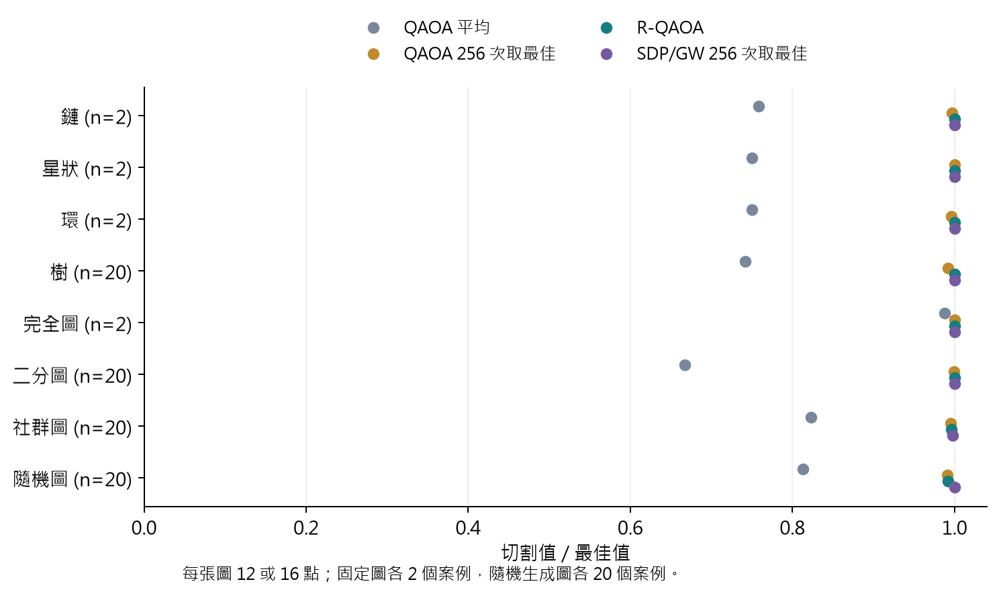
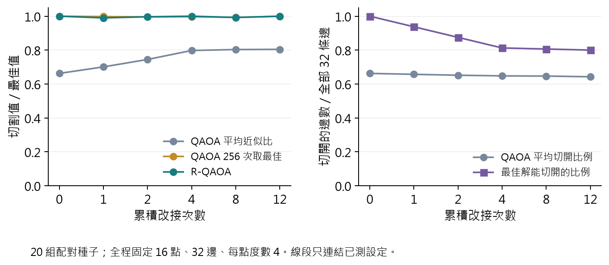
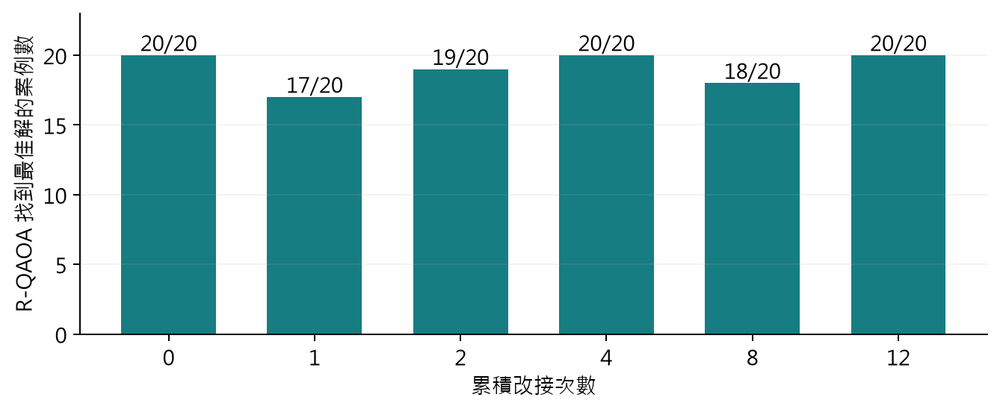
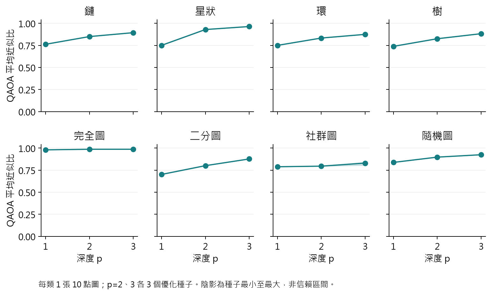
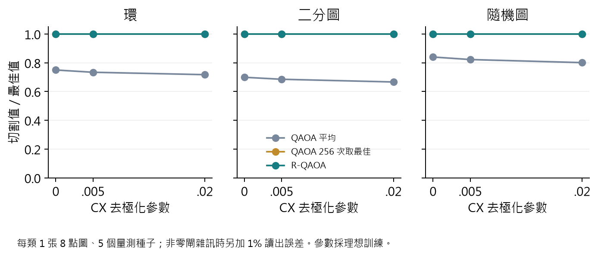

# 第 9 題研究報告：圖結構與 Recursive QAOA

## 結論：R-QAOA 的改善取決於結構與評分指標

第 9 題研究報告｜2026-11-07｜Johnny 負責的 Recursive QAOA 路線

## 研究問題回到第 9 題

不同網路形狀，會如何影響標準 QAOA 與 R-QAOA 解 MaxCut 的結果？R-QAOA 能救回哪些情況，哪些仍會失敗？本報告以圖結構比較為主線，錯誤消去分析只用來解釋結果，沒有改成損失預測或機器學習題目。

## 本輪最重要的三個發現

**一、R-QAOA 在部分結構很好，但沒有全面反轉。** 八類圖比較中，鏈、星狀、環、樹、完全圖及二分圖的本次案例均找到最佳解；社群圖、一般隨機圖仍有失敗。整輪 208 個主案例，R-QAOA 成功 197 個；32 起點古典搜尋 206 個，SDP／GW 對照 207 個。沒有支持量子優勢的證據。

**二、近似比變高，可能同時伴隨實際切割分數變低。** 固定 16 點、32 邊、每點度數 4，從二分結構逐步改接後，QAOA 平均近似比由 0.6624 升至 0.8043；但平均切開比例由 0.6624 降至 0.6425。最佳值降低是比值上升的重要原因，不能只看近似比就說圖更容易。

**三、改接越多，R-QAOA 並沒有單調變差。** 20 組配對案例中，改接 1、2、4、8、12 次的成功數為 17、19、20、18、20。尚未找到單一「挫折超過某值就翻車」的界線。

## 這份研究新增什麼

新增 208 個主圖案例，其中八類圖 88 個、固定度數控制組 120 個；另有 72 筆深度設定和 45 筆小圖雜訊設定。後兩者分別只涉及 8 張、3 張圖，不能加總成 325 張獨立圖。原先 98 圖 pilot 沒有混入本輪平均，部分設定可重複生成相同原圖。

這是一份可重現的結構與指標診斷研究，沒有宣稱新演算法、世界首次或計算加速。

---

## 怎麼對應原題、Team 9 與既有研究

## 原題要求與本次交付

原題比較不同圖形的 MaxCut、近似比、最佳解機率、收斂與深度；進階再看結構、噪音及閘成本。本次補齊八類圖與標準 QAOA 的 p=1、2、3 小圖測試，主方法比較固定 p=1，包含原版與兩個 R-QAOA 變體、古典對照、控制改接、失敗記錄及 Aer 閘雜訊。

尚未完成：真機、硬體拓樸與 routing、p=2／3 的 R-QAOA、端到端含噪訓練、精確自同構群的對稱性分析，以及總 QPU 資源完全匹配。報告不把這些未做項目寫成已完成 Advanced 全部要求。

## Team 9 有一個必須修正的解讀

依原簡報第 9、16 張，二分圖的近似比隨密度增加而下降；一般隨機圖則上升。因此最初摘要的「高密度隨機圖都很差」不符合簡報。簡報第 8 張的 optimal-solution degeneracy 是最佳解簡併度，與 k-core 圖退化度不同；本次分別記錄。

本次使用自行生成的圖，沒有重跑 Team 9 儲存庫或逐張重建其數值，屬獨立延伸，並非完整逐項重現。

## 文獻讓我們知道哪些不能當原創

Herrman 等已研究圖結構與 QAOA 的關聯；Bravyi 等提出 R-QAOA；Bae 等對二分圖提出受限參數域方法。這些工作分別支持「結構值得研究」與「遞迴能改善特定設定」，但不替我們保證所有自建圖成功。

2026-10-31 提交的 Tree-IQO 預印本進一步研究貪婪消去失敗、回溯與界限搜尋。因此本報告不把「選錯會刪最佳解」或「加入回溯」當首次發現。

我們的差異定位是：對第 9 題補一組固定點數、邊數與度數的配對改接實驗，把平均分數、最佳可得答案、分母變化與消去錯誤一起分析。這是本專案的實驗設計差異，沒有做完文獻普查以證明其首創。

---

## 實驗設計：先固定比較方式，再解讀結果

## 八類圖與控制圖

八類圖測 12、16 點。鏈、星狀、環與完全圖各兩個固定案例；樹、二分、社群和一般隨機圖，每大小各 10 個種子。二分／隨機圖生成邊機率 0.5；社群圖同群 0.7、跨群 0.15。家族樣本數不相同，因此只作描述性比較。

主控制組先生成連通四正則二分圖，再把兩條左右連線改接成兩條同側連線。每次改接都保持連通、16 點、32 邊及每點度數 4。每個種子保留改接 0、1、2、4、8、12 次的快照，共 20 組、120 個案例。

我們要求整條改接路徑能完成，所以這是有建構條件的圖分布；不是所有四正則圖的均勻抽樣。改接次數不是實際挫折量，原左右分法也不一定一直最佳。每張圖重新計算最佳值、三角形及是否仍二分。

## 方法與參數

QAOA1 用解析期望值搜尋參數，gamma 至少 129 點並細化前 4 個峰，beta 解析選取。原版 R-QAOA 只在非零耦合邊上取最大絕對相關性；另測先前程式的 all-pairs 版本，以及依 Bae 等參數域的 edge-only 版本。每次消去一個點，到 4 點窮舉，再反向還原。

受限版本使用 |gamma|≤pi/(2 max|w|)、0<beta<pi/4；採有限網格數值優化，不提供數學全域證書。遇到無邊時提前精確處理。所有縮圖保留正負權重，最終回原圖計分。

古典對照含 32 起點單點翻轉，以及 SCS 數值求解 SDP 後做 256 次超平面取整。GW 是數值實作，經小負特徵值截斷後取整，沒有宣稱本次 SDP 值為嚴格數學證書。

所有 12、16 點主圖均枚舉最佳值。圖密度、度數方差、聚類、三角形、k-core 退化度、最佳切割簡併度與挫折比例都有記錄；簡併度除去整體對調兩組的重複。

---

## 八類圖：遞迴改善平均分數，古典對照仍很強

| 圖類 | 案例數 | QAOA 平均 | 256 次取最佳 | R-QAOA | SDP/GW |
|---|---:|---:|---:|---:|---:|
| 鏈 | 2 | 0.7586 | 0.9968 | 1.0000 | 1.0000 |
| 星狀 | 2 | 0.7500 | 1.0000 | 1.0000 | 1.0000 |
| 環 | 2 | 0.7500 | 0.9963 | 1.0000 | 1.0000 |
| 樹 | 20 | 0.7418 | 0.9920 | 1.0000 | 1.0000 |
| 完全圖 | 2 | 0.9879 | 1.0000 | 1.0000 | 1.0000 |
| 二分圖 | 20 | 0.6672 | 0.9997 | 1.0000 | 1.0000 |
| 社群圖 | 20 | 0.8230 | 0.9956 | 0.9961 | 0.9975 |
| 隨機圖 | 20 | 0.8133 | 0.9915 | 0.9923 | 1.0000 |

各值為切割值／最佳值，但第一欄數值是答案分布的平均，後三欄是最好答案或還原答案；不能當完全相同的輸出語意。「256 次取最佳」以完整小圖分布精確計算其期望值，另用 30 批抽樣核對，並非一次碰巧抽中的分數。

社群圖與隨機圖分別有 2／20、3／20 個 R-QAOA 失敗。完全圖的高近似比不代表保證容易：最佳值本身接近隨機切割的基準，也要看最佳解機率。

本輪 208 案例中，edge-only、all-pairs 與受限域三個版本的最終切割值全數相同；不表示參數、路徑或一般情況等價。這批無權小圖沒有顯示受限域版本額外改善，不能把文獻定理誤推到一般含挫折圖。

---

## 控制實驗：近似比上升，不等於切得更多

| 改接次數 | 挫折比例 | 三角形均數 | QAOA 平均近似比 | QAOA 切開比例 | R-QAOA 成功 |
|---|---:|---:|---:|---:|---:|
| 0 | 0.0000 | 0.00 | 0.6624 | 0.6624 | 20/20 |
| 1 | 0.0625 | 1.70 | 0.7007 | 0.6569 | 17/20 |
| 2 | 0.1250 | 3.45 | 0.7446 | 0.6516 | 19/20 |
| 4 | 0.1875 | 4.75 | 0.7976 | 0.6477 | 20/20 |
| 8 | 0.1938 | 5.15 | 0.8032 | 0.6465 | 18/20 |
| 12 | 0.2000 | 6.55 | 0.8043 | 0.6425 | 20/20 |

挫折比例定義為 (邊數－最佳切割值)／邊數，用來描述此圖不能全部切開的程度；本次可枚舉得到，未把它當未知大圖上免費可得的特徵。

由 0 到 12 次改接，配對平均近似比變化為 +0.1419，95% 種子配對 bootstrap 區間 [0.1295, 0.1550]；實際切開比例變化為 -0.01985，區間 [-0.02179, -0.01804]。20 組種子以整組重抽 20,000 次，同一路徑各快照沒有當獨立樣本。

近似比是平均切割值除以最佳值。本控制組總邊數固定，分母下降足以使比值上升，即使分子也下降。這是本批數據的算術解釋；不代表三角形、挫折或某一結構特徵單獨造成所有變化。

---

## R-QAOA 何時失敗？目前沒有單調的結構界線

## 已觀察到的反例

控制組只有一次改接時，已有 3／20 個案例失敗；改接 4 次時卻全部成功，8 次又有 2 例失敗，12 次再次全成功。因此「離二分越遠就一定越差」不符合本批樣本，也不能只從三角形數量設定通用安全閾值。

## 失敗發生在具體消去決定

11 個失敗案例共找到 12 次不可逆分數損失。以隨機 12 點、seed=4 為例，第一步固定某兩點異組，使最佳可得值由 25 降到 23；另一張 16 點圖連續兩步由 40 降為 39、38。控制圖也有第一步直接損失 2 分的案例。

這裡的「最佳可得值」均是在已接受限制之下，用原圖枚舉作事後核對。它只是解釋工具，沒有在求解時提示演算法最佳答案。

有些錯誤發生在候選相關性平手時，但也有非零差距的錯誤，所以不能直接把「差距大」解讀為一定安全。對 11 個失敗原圖，另以 4,097 點 gamma 網格及更多峰值細化檢查第一輪期望值，最大增加約 7.1e-15；未看到原圖根節點因粗網格而明顯漏峰。但沒有因此證明所有縮圖節點的參數皆全域最佳。

本輪沒有訓練損失預測器，也沒有把停止控制器當主題；這些診斷服務於第 9 題的圖結構解釋。

---

## 增加深度的效果依圖而異，參數優化也會影響判讀

| 圖類 | p=1 平均近似比 | p=2 | p=3 |
|---|---:|---:|---:|
| 鏈 | 0.7623 | 0.8499 | 0.8942 |
| 星狀 | 0.7500 | 0.9298 | 0.9638 |
| 環 | 0.7500 | 0.8333 | 0.8750 |
| 樹 | 0.7389 | 0.8254 | 0.8827 |
| 完全圖 | 0.9804 | 0.9869 | 0.9869 |
| 二分圖 | 0.7014 | 0.8010 | 0.8772 |
| 社群圖 | 0.7887 | 0.7955 | 0.8299 |
| 隨機圖 | 0.8379 | 0.8978 | 0.9251 |

每類只有 1 張 10 點圖。p=2、3 各用 3 個優化種子與插值暖啟動，L-BFGS-B 名目 maxfun=800，實際評估數另存 CSV；若新深度沒找到更好值，保留可嵌入的較低深度解。因此不下降部分是選擇規則所致，不是實驗證明每次優化都自然改善。

最初 Powell 試跑改善偏少，於是保留 pilot 檔，改用插值暖啟動與梯度式局部搜尋；這是事後方法改善，不是預先註冊結果。社群圖 p=3 的三種子結果約 0.8060 至 0.8419，顯示同一圖也有優化穩定性問題。

深度表是標準 QAOA；R-QAOA 這輪仍固定 p=1。沒有把更深一定有效、或任何局部極值當成已證明的全域最優。

---

## 小圖閘雜訊：平均分數降低，尚不足以證明遞迴耐噪

## 做了什麼

三張 8 點圖，每張測無噪、CX 去極化參數 0.005、0.02；非零閘雜訊時另有 1% 讀出錯誤，每設定 5 個量測種子。以 Aer density_matrix 執行，RZZ 分解為 CX、RZ，所有 CX 套用相同自訂錯誤，每個線路 4,096 shots。

QAOA 與 R-QAOA 每一步的參數都先以理想期望值訓練，僅在執行／消去決策時加入噪音。沒有使用 IBM 校準資料、T1／T2、硬體 routing、量子位元連接限制或含噪優化。

## 結果怎麼解讀

由無噪到去極化參數 0.02，QAOA 平均近似比：環圖約 0.7496 降至 0.7172，二分圖約 0.6990 降至 0.6663，隨機圖約 0.8398 降至 0.8009。這是閘與讀出擾動合併的敏感度，不是單獨隔離讀出效應。

在這些小圖與大量 shots 下，標準 QAOA 每批 256 次取最佳及 R-QAOA 都得到最佳解。這說明平均分數下降不必然使最後最好答案下降；但只有三張圖、每設定五個種子，不能據此宣稱 R-QAOA 對大型圖或真機具普遍耐噪能力。

抽樣批次由 counts 轉成樣本後先打亂，避免把同結果聚集的字典順序誤當量測時間順序。R-QAOA 使用多個遞迴線路，每輪 4,096 shots，總 shots 比標準單線路更多；這不是完全相同 QPU 預算下的比較。

---

## 成本、驗證與限制：結果能支持到哪裡

## 古典成本對照

| 方法 | 本輪成功案例／208 | 平均本機核心運算秒數 |
|---|---:|---:|
| edge-only R-QAOA | 197 | 0.1516 |
| 受限參數域 R-QAOA | 197 | 0.1492 |
| 古典 32 起點 | 206 | 0.0032 |
| SDP/GW，256 次取整 | 207 | 0.0115 |

R-QAOA 時間沿用快取的第一輪 fit，該次優化時間未再加回；另有每圖 QAOA fit 平均 0.0215 秒。計時有並行程序與單次測量影響，非受控速度基準，也未含 QPU 排隊、通信和真正量測成本。即使如此，本次沒有勝過古典方法的證據。

## 結果驗證

208 個主案例的 QAOA 解析期望值與 Qiskit 完整分布核對，最大誤差約 2.2e-12。三個 R-QAOA 版本所有答案皆以原圖逐邊重算；控制組全部確認點數、邊數、度數與連通性不變。深度模擬與 Qiskit 的小圖機率核對最大誤差約 1.6e-16。

GW 的 SCS 矩陣最小特徵值約至 -5.9e-6，屬數值誤差；取整時截為非負。所有候選分組的分數均可驗算，但 SDP 目標值不當嚴格上界證書。

## 仍要保留的限制

全圖最佳值只在小圖枚舉；本研究規模不足以推出大圖優勢。p=1 相關性可古典解析計算，因此這個流程的本機成功不代表量子加速。各變體最終分數相同也不代表所有圖等價。結構相關性有多個共同變動特徵，控制度數後仍不是單獨操控三角形的因果實驗。

標準 QAOA 平均、best-of-256、遞迴最終解的語意與成本不同。本次結果應定位為結構與評估方式的實測分析，而非公平總 QPU 預算下的效能定論。

---

## 參賽定位與重現方式

## 建議用這個主題回報

「不同圖結構下 Recursive QAOA 的改善與限制：以固定度數改接實驗區分近似比、最佳答案與不可逆消去。」

這是 AI 依實測提出的題目定位，尚非團隊正式決定。它直接回應第 9 題的圖結構比較，延續最初方案 B；R-QAOA 是主要方法，損失診斷是解釋結果的附屬分析。

## 可以向隊友說

「我把八類圖的 R-QAOA 比較補齊，也做了固定點數、邊數、度數的控制改接。R-QAOA 能在一些圖上找回最佳解，但一般社群／隨機圖仍會選錯關係。近似比變高有時只是最佳值降低，不能直接解讀成更擅長。現在最有內容的是解釋圖結構、指標和錯誤消去怎麼一起影響結論，而不是宣稱量子勝過古典。」

## 下一個優先實驗

   讓 Warm-start 成員使用相同邊清單、最佳值與評分方式，加入同一張結構比較表。若要新增演算法改良，先指定一類確實失敗的結構，再選已有文獻方法作對照；不能只把回溯或加深包裝成全新方法。

下一階段應補未見種子、較大圖、同成本比較，以及有限 shots 的完整參數優化。本輪控制圖與評分程式可直接重用，暫不需要另開機器學習主題。

## 程式與資料

research/q9_study.py：208 圖主實驗與 GW。research/q9_depth_noise.py：深度及 Aer 雜訊。research/q9_analyze.py：配對 bootstrap、失敗步驟與網格敏感度。research/q9_protocol.json：跑前寫下的範圍；這輪已參考既有 pilot，不是正式預先註冊研究。

research/q9_results/main.csv 與 graphs_and_traces.json：全部主圖指標、邊清單、逐步參數和解。depth.csv、noise.csv：補測。analysis.json 與各 audit.json：統計及驗證。舊版結果保留，不與本輪混算。

## 主要來源

[1] 原始題目照片與 Team_9.pptx。

[2] [Herrman 等：圖結構與 QAOA](https://arxiv.org/abs/2102.05997)。

[3] [Bravyi 等：R-QAOA 原始研究](https://arxiv.org/abs/1910.08980)。

[4] [Bae 等：受限參數域與二分圖](https://arxiv.org/abs/2408.13207)。

[5] [Hadfield 等：Tree-IQO 預印本](https://arxiv.org/abs/2611.00678)。

[6] [IBM：Aer 噪音模型文件](https://quantum.cloud.ibm.com/docs/en/guides/build-noise-models)。

[7] [Ozaeta 等：單層 QAOA 期望值](https://arxiv.org/abs/2012.03421)。